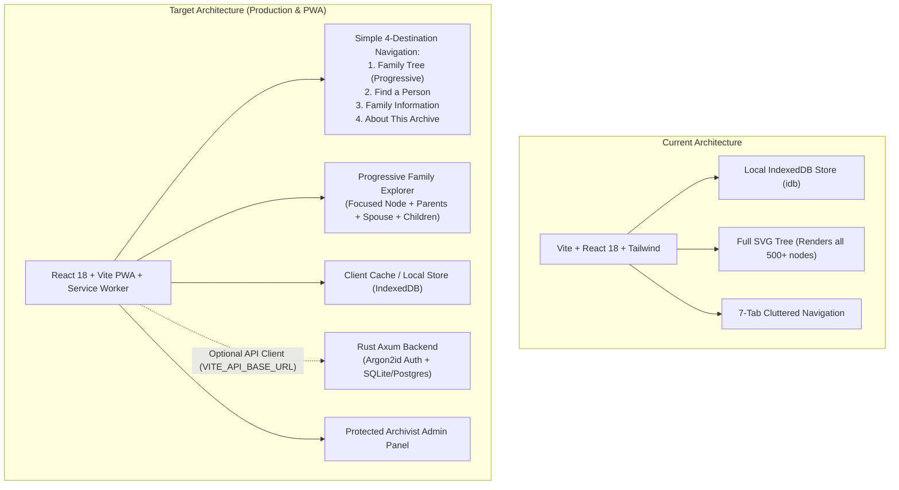

# Kinteba Guush Family Genealogy — Architectural Redesign Plan

**Project:** Kinteba Guush Family Genealogy (`ሓረግ ወለዶ ከንቲባ ጉዑሽ ሓጎስ`)  
**Workspace:** `C:\Users\Bale\My_ALL_PROJECTS\1\Kinteba_Guush_Family_Genealogy`  
**Git Branch:** `redesign-architecture` (Production checkpoint: `main` / `pre-redesign-checkpoint`)  
**Date:** October 9, 2026  
**Status:** Approved for Phased Execution  

---

## 1. Current Architecture vs. Target Architecture



### Comparative Architecture Matrix:

| Component | Current Implementation | Redesigned Implementation |
| :--- | :--- | :--- |
| **Family Tree Navigation** | Enormous all-at-once SVG canvas with pan/zoom. Difficult for large trees. | **Progressive-disclosure Family Explorer**. Focuses on selected person + immediate family (parents, spouse, children) with branch expand/collapse. |
| **Navigation Structure** | 7 top-level tabs mixing visitor browsing with technical administration. | **4 primary visitor destinations** (Family Tree, Find a Person, Family Information, About This Archive) + protected Archivist Admin area. |
| **Accessibility (All Ages)** | Standard web controls, hover-dependent elements. | **Touch targets ≥ 44–48px**, high contrast, readable Ethiopic typography, visible keyboard focus, no hover dependencies. |
| **Mobile & Installation** | Standard responsive webpage. | **Progressive Web App (PWA)** with `manifest.webmanifest`, service worker offline shell, Android install prompt, iOS Add-to-Home instructions. |
| **Backend & Security** | Client-side only with optional Supabase client stub. | **Standalone Rust (Axum) API** in `backend/` with SQLite/Postgres, Argon2id auth, rate limiting, parameterized queries, and audit log. |
| **Frontend Deployment** | Static build deployed via Netlify (`dist/`). | **Preserved 100%**. Rust backend resides in `backend/` and does not alter `npm run build` or Netlify static hosting. |
| **Data Integrity** | 539 persons, 538 occurrences, 348 relations, 92 repeated-name groups preserved. | **Zero change to historical integrity.** Exact Ge'ez spelling and provenance preserved. Explicit import approval retained. |

---

## 2. Implementation Phases & Milestones

1. **Phase 1: Repository Inspection & Protection (Done)**
   - Switched to dedicated branch `redesign-architecture`.
   - Production checkpoint branch `pre-redesign-checkpoint` secured.
   - Verified that original sources (`source/ከሰተ-ብርሃነ.pdf`, `source/family_genealogy_register.md`) are untouched.
   - Added production `netlify.toml` with security headers and SPA routing.

2. **Phase 2: UX & Family-Tree Redesign**
   - Implement `CompactFamilyExplorer.tsx` with progressive disclosure (focus person, parent card, spouse card, children cards with expand/collapse badges, breadcrumbs).
   - Implement `AboutArchive.tsx` documenting historical archive context and scribe Kesete Birhane Weldu.
   - Refactor `Navbar.tsx` into clean 4-destination navigation + mobile bottom navigation bar.
   - Enhance `Directory.tsx` with fast search, branch filters, and shared-name distinction badges.
   - Update `PersonDetailModal.tsx` and detail views for high contrast and elder-friendly readability.

3. **Phase 3: Genealogy Integrity Verification**
   - Ensure 539 people, 348 relationships, 92 repeated name groups, 18 continuations, and 6 uncertain records continue to pass all tests.
   - Maintain explicit user approval gate in `ImportModal.tsx`.

4. **Phase 4: PWA Implementation**
   - Create `public/manifest.webmanifest` with icons, theme colors, and standalone display.
   - Create `public/sw.js` with offline shell caching and cache-first strategies.
   - Register service worker in `index.html` / `src/main.tsx`.
   - Add PWA install banner and iOS install instructions in `src/components/PwaInstallPrompt.tsx`.

5. **Phase 5: Rust Backend & Security Architecture**
   - Create `backend/` directory with `Cargo.toml` and Axum server.
   - Implement SQLite database schema with migrations.
   - Implement Argon2id password hashing, JWT/token authentication, and authorization middleware.
   - Implement secure admin CLI tool (`init-admin`) for safe administrator creation.
   - Ensure zero disruption to frontend npm build.

6. **Phase 6: Protected Administrator Panel**
   - Build `AdminPanel.tsx` with password login, statistics dashboard, person/relationship editor, and audit log.
   - Implement safeguards against accidental cascade deletions.

7. **Phase 7: Integration, Testing & Quality Assurance**
   - Run Vitest tests, TypeScript checks, and production Vite build.
   - Verify mobile responsiveness and accessibility.

8. **Phase 8: Documentation & Final Delivery**
   - Update `README.md`, `docs/DATA_MODEL.md`, `docs/SECURITY.md`, `docs/PWA_INSTALLATION.md`, `docs/ADMIN_GUIDE.md`, `docs/SETUP_AND_DEPLOYMENT.md`.

---

## 3. Risks, Mitigations & Rollback Procedure

- **Risk:** Build failures on Netlify if backend files interfere.  
  **Mitigation:** Rust code is strictly isolated in `backend/`. The root `package.json` and Vite configuration remain unchanged. A dedicated `netlify.toml` ensures static build commands remain `npm run build` with publish directory `dist`.
- **Risk:** Accidentally merging repeated names during UI redesign.  
  **Mitigation:** Automated tests enforce 92 distinct groups with stable IDs (`pers_p...`).
- **Rollback Procedure:**  
  If any regression occurs, switch back to the original branch:
  ```powershell
  git checkout main
  ```

