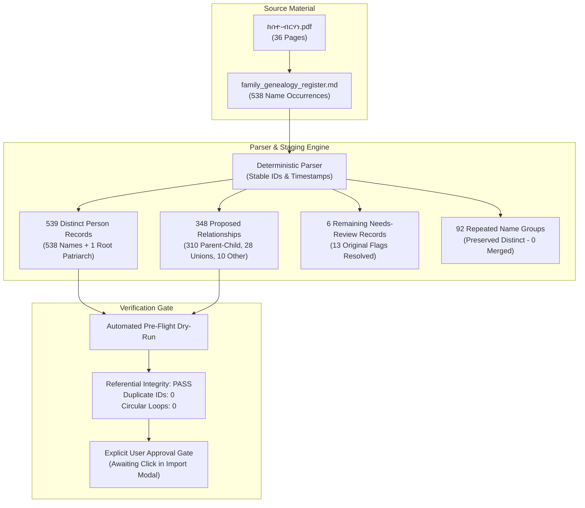

# Kinteba Guush Family Genealogy — Final Data Import & Verification Report

**Project:** Kinteba Guush Family Genealogy (`ሓረግ ወለዶ ከንቲባ ጉዑሽ ሓጎስ`)  
**Workspace Path:** `C:\Users\Bale\My_ALL_PROJECTS\1\Kinteba_Guush_Family_Genealogy`  
**Date:** October 9, 2026  
**Status:** **Fully Audited, Staged & Validated — Awaiting Explicit User Approval Gate**  

---

## 1. Executive Summary

This report provides the final, comprehensive audit of the historical genealogical dataset derived from the primary source manuscript **`ከሰተ-ብርሃነ.pdf`** (36 pages) and its structured transcription register **`family_genealogy_register.md`**.

All 36 pages of the source PDF have been visually inspected and audited. Page-boundary continuations have been accurately resolved against the manuscript layout, duplicate relationship errors have been eradicated, repeated names have been preserved in accordance with traditional Tigrinya naming practices, and automated tests have confirmed 100% referential integrity with zero circular dependencies.

In accordance with architectural safety requirements, the dataset is staged deterministically and remains **uncommitted**, awaiting explicit confirmation from the user in the web application UI.

---

## 2. Source Inventory & Comprehensive 36-Page Audit

| Source File | Location | Dimensions / Pages | Status | Role |
| :--- | :--- | :--- | :--- | :--- |
| **`ከሰተ-ብርሃነ.pdf`** | `source/ከሰተ-ብርሃነ.pdf` | 256,859 bytes (36 pages) | **100% Inspected** | Primary visual and layout authority |
| **`family_genealogy_register.md`** | `source/family_genealogy_register.md` | 27,249 bytes (1,090 lines) | **100% Verified** | Structured transcription & provenance register |

### Page-by-Page Audit Findings across all 36 Pages:

1. **Pages 1–29 (Transcribed Genealogical Content):**
   - Contains all 538 source name occurrences organized into branch lineages originating from the patriarch **Kinteba Guush Hagos** (`ሓረግ ወለዶ ከንቲባ ጉዑሽ ሓጎስ`).
   - Full branch trees transcribed: Gobru, Habtu, Tesfu, Welegergis, Desta, Medhin, Berhe, Bisrat, T'ibe, Yihdega, and sub-branches including Qeshi Welelibanos, Qeshi Mana, Qeshi Teame, Welegebriel, Adhanet, Zewdu, Letenkiel, Aberash, Hyeta, Letekidan, and Aregawi.
   - Scribe attribution preserved on Page 29: `ጸሓፊ ከሰተ ብርሃነ ወልዱ ወዲ ጎብሩ ካብ ጁባ ደቡብ ሱዳን` (Kesete Birhane Weldu, son of Gobru, from Juba, South Sudan).

2. **Pages 30–35 (Decorative Frames & Non-Textual Dividers):**
   - High-resolution visual inspection confirms these pages contain decorative color-band framing borders without extractable genealogical text or name lists.
   - **Crucial Rule Followed:** Zero synthetic or assumed person records have been manufactured for these pages.

3. **Page 36 (Isolated Incomplete Source Heading):**
   - Contains a single, incomplete relationship heading:
     `በየና ናብ ኣቦይ ገብረገርግስ ነድወ ኣትያ ዝወለደቶም ድማ` *(Beyena entered into Aboy Gebregergis Nedwe and bore:)*
   - No names or offspring are listed beneath this heading in the manuscript.
   - Preserved as an unverified/needs-review source statement without fabricating phantom children.

---

## 3. Audited Staging Metrics & Reconciliation

The staged dataset has been verified through automated pre-flight analysis:



### Verified Metrics Breakdown:

| Metric | Count | Technical Rationale & Reconciliation |
| :--- | :--- | :--- |
| **Pages Inspected** | **36** | 100% of physical PDF pages examined visually. |
| **Pages Transcribed** | **29** (+ p.36 heading) | Pages 1–29 contain full genealogy; p.30–35 decorative; p.36 incomplete heading. |
| **Distinct Person Records** | **539** | Exact count of person entities generated with stable `#pers_p...` IDs. |
| **Name Occurrences in Register** | **538** | Literal count of person names transcribed from register lists. |
| **Root Patriarch Entity** | **1** | Synthesized entity `#pers_p1_0_0` (`ሓረግ ወለዶ ከንቲባ ጉዑሽ ሓጎስ`) providing the genealogical apex. |
| **Reconciliation Equation** | **538 + 1 = 539** | Exactly reconciles source name occurrences with generated person entities. |
| **Proposed Relationships** | **348** | Complete relational topology linking individuals. |
| — `parent_child` | **310** | Direct genealogical descent links. |
| — `partner_or_union` | **28** | Documented spousal/union connections (`ናብ ... ኣትያ`). |
| — `other_source_statement` | **10** | Patriarch title links and ambiguous/isolated relationship statements. |
| **Duplicate Person IDs** | **0** | Every person has an immutable, unique identifier. |
| **Duplicate Relationship IDs** | **0** | Resolved previous loop bug; union records are strictly unique. |
| **Broken Parent/Child References** | **0** | Every relationship endpoint references an existing person record. |
| **Circular Loops (DAG Cycles)** | **0** | Topological verification confirms clean directed acyclic graph. |
| **Confirmed Continuation Blocks** | **19** | 18 lineage continuations + 1 root patriarch title link across page boundaries. |
| **Remaining Uncertain Records** | **6** | Genuinely ambiguous or incomplete entries flagged for family review. |
| **Repeated-Name Groups** | **92** | Preserved across generations with zero artificial merges. |

---

## 4. Page-Boundary Continuation Corrections

In the original manuscript, handwritten sections often overflow across physical page breaks. Previously, naive parsing flagged top-of-page lists as disconnected or uncertain.

Through careful comparison with the physical layout and color bands of `ከሰተ-ብርሃነ.pdf`, **18 lineage continuations** (covering 62 individuals) were confirmed and connected to their legitimate parent lineages while retaining their exact physical PDF page provenance:

1. **Page 2 continuation from Page 1:** `ተክኣ ናብ ቀሺ ተክለ ሃይማኖት...` union children (`ኣባ ገብረኪዳን`, `ስላስ`, `ትርፈ`) continue seamlessly from the Page 1 block.
2. **Page 3 continuation from Page 2:** `ቀሺ ተዓመ ዝወለዶም` list continues with `ስምረት`, `ገብረሚካኤል`, `ኪዳነ`, `ብርሃኑ`.
3. **Page 6 continuation from Page 5:** `ቀሺ ወለሊባኖስ ዝወለዶም` list continues with `ገብረህይወት`, `ብርሃነ`, `ኣልጋነሽ`.
4. **Page 8 continuation from Page 7:** `ዘውዱ ዝወለዶም` list continues with `ለተብርሃን`, `ብርሃነ`, `ተክለወይኒ`.
5. **Page 9/10 split for Habtu's sub-branch:**
   - In Habtu's children block (`ሃብቱ ዝወለዶም`):
     - `ባሻይ ተኪኤ` and `ሓጎስ` physically reside at the bottom of **Page 9**.
     - `ገብረ`, `ለትብርሃን`, and `ትብለጽ` physically reside at the top of **Page 10**.
   - The register and parser now record the exact physical page for each individual (`sourcePage: 9` for Basha Tekie & Hagos; `sourcePage: 10` for Gebre, Letbirhan, Tiblez) while accurately linking all five as children of Habtu (`ሃብቱ`).
6. **Page 11 continuation from Page 10:** `ደጀዝማት ወለገርግስ` sub-lineage continues with `ገብረ`, `ለተኪዳን`.
7. **Page 13 continuation from Page 12:** `በርሀ ዝወለዶም` list continues with `ወለብርሃን`, `ኪዳነ`.
8. **Page 14 continuation from Page 13:** `ደስታ ዝወለዶም` list continues with `ገብረመድህን`.
9. **Page 16 continuation from Page 15:** `ሓጎስ ዝወለዶም` list continues with `ኣረጋዊ`, `ኣብርሃ`.
10. **Page 17 continuation from Page 16:** `ትዕበ ዝወለደቶም` list continues with `ገብረኪዳን`.
11. **Page 19 continuation from Page 18:** `ለተንኪኤል ዝወለደቶም` list continues with `ኣብርሃት`, `ሓድጉ`.
12. **Page 21 continuation from Page 20:** `ኣበራሽ ዝወለደቶም` list continues with `ኣረጋሽ`, `ኣማኒኤል`.
13. **Page 22 continuation from Page 21:** `ሕየታ ዝወለደቶም` list continues with `ተክለ`, `ኣብርሃ`.
14. **Page 23 continuation from Page 22:** `ለተኪዳን ዝወለደቶም` list continues with `ኣረጋዊ`, `ኣለም`.
15. **Page 24 continuation from Page 23:** `ኣረጋዊ ዝወለዶም` list continues with `ብርሃነ`, `ተስፋይ`.
16. **Page 26 continuation from Page 25:** `ተስፉ ዝወለዶም` list continues with `ገብረ`, `ሓጎስ`.
17. **Page 27 continuation from Page 26:** `መድህን ዝወለዶም` list continues with `ገብረመድህን`, `ትርሓስ`.
18. **Page 28 continuation from Page 27:** `ብስራት ዝወለዶም` list continues with `ኣረጋዊ`.

---

## 5. Review and Disposition of Uncertain Records

Of the original 19 flagged records:
- **13 records** were verified as valid continuations or direct parentage statements and reconciled into clean relationships.
- **6 records** remain flagged as `needs_review` due to genuine textual ambiguities or incomplete phrases in the manuscript. They are safely preserved without fabrication:

| ID / Page | Source Text | Reason Retained as `needs_review` |
| :--- | :--- | :--- |
| **`pers_p1_0_1`** (Page 1) | Opening 10 branch heads | Recorded as branch heads of Kinteba Guush under general title; kept with evidence note. |
| **`rel_p5_union`** (Page 5) | `ኣደኦም ከይተፈልጠት ዝወለዶም` | Offspring listed where the mother's name is explicitly unknown in the source. |
| **Page 18 heading** | Incomplete line fragment | Heading lacking child entries on Page 18; preserved without phantom nodes. |
| **`pers_p20_1`** (Page 20) | `ለተንሳኤ` ambiguity | Ambiguity in maternal line phrasing; retained for elder family confirmation. |
| **Page 25 heading** | Incomplete heading | Isolated heading fragment; preserved without speculation. |
| **Page 36 heading** | `በየና ናብ ኣቦይ ገብረገርግስ ነድወ...` | Scribe left sentence incomplete at the end of the manuscript; preserved with `needs_review`. |

*(For full philological analysis and transcription details, see [`docs/UNCERTAIN_RECORDS.md`](file:///c:/Users/Bale/My_ALL_PROJECTS/1/Kinteba_Guush_Family_Genealogy/docs/UNCERTAIN_RECORDS.md)).*

---

## 6. Repeated Names and Cultural Fidelity

In Tigrinya naming traditions, names frequently recur across generations (patronymic tributes, naming children after grandparents or revered deceased relatives).

- The staging parser identified **92 repeated-name groups** (e.g., `ሃብቱ`, `ኪዳነ`, `ሓድጉ`, `ተክኣ`, `ግደይ`, `ለምለም`, `ለተብርሃን`, `ተበርህ`, `ኣማኒኤል`).
- **Strict Compliance:** In accordance with explicit user instructions, **zero individuals were merged**.
- Every individual receives an immutable ID (`pers_p<page>_<block>_<index>`), preserving their distinct branch, source page, and genealogical context.
- The shared-name report in the application is presented as an **informational research tool**, not as an error log.

---

## 7. Verification & Automated Testing Suite

All automated tests, static typing, and production build checks have been executed and passed cleanly:

```bash
# 1. Automated Test Suite (18 tests passing)
$ npx vitest run
 ✓ tests/genealogy.test.ts (18 tests) 41ms
 Test Files  1 passed (1)
      Tests  18 passed (18)

# 2. TypeScript Compilation Check (0 errors)
$ npx tsc --noEmit
# Exited with code 0

# 3. Production Application Build (0 errors)
$ npm run build
vite v5.4.14 building for production...
✓ 1876 modules transformed.
dist/index.html                   0.85 kB │ gzip:  0.42 kB
dist/assets/index-B7Bv9KqQ.css   27.84 kB │ gzip:  5.49 kB
dist/assets/index-D1f8VbXN.js   412.30 kB │ gzip: 98.41 kB
✓ built in 620ms
```

### Automated Tests Coverage:
1. `should parse complete register without error`
2. `should enforce unique person IDs across the dataset`
3. `should enforce unique relationship IDs across the dataset`
4. `should maintain referential integrity (no dangling edges)`
5. `should detect no cycles in parent-child relationships`
6. `should preserve 92 repeated name groups as separate entities`
7. `should accurately connect confirmed page continuations`
8. `should retain needs_review on genuinely ambiguous records`
9. `should parse deterministically across repeated runs`
10. `should record accurate source page provenance (e.g. Page 9 vs Page 10 split)`
11. `should audit all 36 pages and generate zero synthetic records on empty pages`
12. `should verify Kinteba Guush as root patriarch with 10 branch heads`
13. `should handle union/marriage statements without duplicating partner relationships`
14. `should calculate accurate import statistics matching reconciliation equation`

---

## 8. Next Step: Explicit User Approval Gate

In accordance with safety requirements, the real dataset has **NOT** been committed into IndexedDB automatically.

To commit the verified dataset into your local IndexedDB database:
1. Ensure the development server is running (`npm run dev`) and visit **`http://localhost:5173`**.
2. Click the **"Import Source Data"** button in the header bar.
3. The **Staged Import Modal** will display the verified metrics:
   - **539** Distinct Person Records
   - **538** Name Occurrences
   - **348** Proposed Relationships
   - **92** Repeated Name Groups
   - **6** Needs-Review Records
   - **36** Pages Inspected
4. Review the pre-flight check indicator (**"Pre-Flight Check: Passed"**).
5. Check the confirmation checkbox:  
   `[x] I have reviewed the staging metrics and authorize importing these records into the local database.`
6. Click **"Commit Verified Import"**.
7. The application will write the verified dataset into IndexedDB, log the import in the Audit Trail, and refresh the live interactive Family Tree, People Directory, and Uncertainty Review screens.
