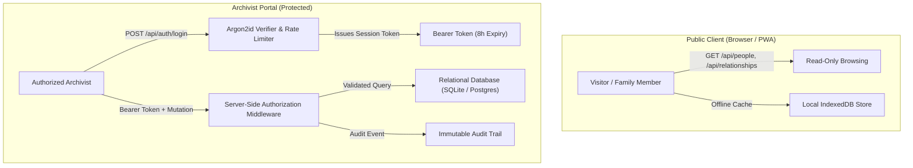

# Kinteba Guush Family Genealogy — Application Security Architecture

**Project:** Kinteba Guush Family Genealogy Platform (`ሓረግ ወለዶ ከንቲባ ጉዑሽ ሓጎስ`)  
**Workspace:** `C:\Users\Bale\My_ALL_PROJECTS\1\Kinteba_Guush_Family_Genealogy`  
**Revision:** 2.0 (Production Security Architecture)  
**Date:** October 9, 2026  

---

## 1. Security Overview & Threat Model

Genealogical databases contain sensitive historical and personal relationship information spanning multiple generations. The Kinteba Guush Family Genealogy platform enforces a **defense-in-depth** security architecture separating public family browsing from protected archivist administration.



---

## 2. Authentication & Password Security

### A. Argon2id Password Hashing
- Administrator credentials are never stored in plaintext.
- The Rust backend uses the **Argon2id** algorithm (memory-hard, resistant to GPU/ASIC cracking) with cryptographic salt generated via `rand_core::OsRng`:
  ```rust
  let salt = SaltString::generate(&mut OsRng);
  let argon2 = Argon2::default();
  argon2.hash_password(password.as_bytes(), &salt);
  ```

### B. Anti-Brute-Force Rate Limiting
- The authentication endpoint (`/api/auth/login`) enforces strict in-memory rate limiting via `LoginRateLimiter`.
- Accounts are throttled after **5 consecutive failed attempts** for a 5-minute lockout window.
- Successful authentications reset the failure counter.

### C. Generic Error Messages
- Failed login attempts return a uniform error message:
  `"Invalid username or password"` (`መእተዊ ሓበሬታ ትክክል ኣይኮነን`).
- Prevents user enumeration attacks by refusing to disclose whether an account exists.

### D. Secure Token Sessions
- Administrator sessions utilize cryptographically random UUIDv4 bearer tokens.
- Tokens expire automatically after 8 hours of inactivity and can be invalidated immediately via `/api/auth/logout`.

---

## 3. Server-Side Authorization Controls

1. **Strict Gatekeeping:**
   - Every mutating endpoint (`POST`, `PUT`, `DELETE` on people, relationships, imports, or restores) requires valid administrator authorization.
   - Authorization is enforced by server-side middleware (`authorize(&headers, &sessions)`). Hiding frontend buttons is never relied upon as a security boundary.
2. **Least Privilege:**
   - Public visitors have access only to read-only endpoints (`/health`, `/api/stats`, `/api/people`, `/api/search`, `/api/relationships`).
3. **Audit Logging:**
   - Every administrative action (login, person creation, modification, deletion, import, restore) is recorded in the `audit_events` table with timestamp, administrator username, and detailed change context.

---

## 4. Database Security & Injection Prevention

1. **100% Parameterized Queries:**
   - All SQL operations utilize parameterized binding (`params![...]` via `rusqlite` / `sqlx`). Dynamic SQL concatenation is strictly prohibited.
2. **Referential Integrity Constraints:**
   - `PRAGMA foreign_keys = ON;` is enforced.
   - Deleting a parent node requires verifying dependent child relationships first (`ON DELETE RESTRICT`) to prevent orphaned records or accidental branch cascading.
3. **Cycle Prevention:**
   - Directed Acyclic Graph (DAG) cycle detectors verify that proposed parent-child relationships cannot create paradoxical circular ancestry loops.

---

## 5. Network, Headers & Deployment Safeguards

1. **Content Security Policy (CSP):**
   - Implemented via `netlify.toml` and Axum security middleware:
     ```
     Content-Security-Policy: default-src 'self'; script-src 'self' 'unsafe-inline'; ...
     ```
2. **Clickjacking & MIME Protection:**
   - `X-Frame-Options: DENY`
   - `X-Content-Type-Options: nosniff`
   - `Referrer-Policy: strict-origin-when-cross-origin`
3. **Zero Secret Exposure:**
   - Production secrets, database credentials, and admin passwords are never committed to version control.
   - First-time administrator creation is executed out-of-band using the secure CLI tool:
     ```bash
     cargo run --bin init_admin -- --username <user> --password <pass>
     ```

